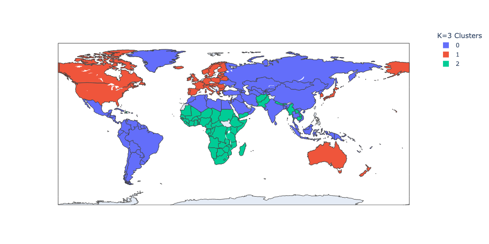
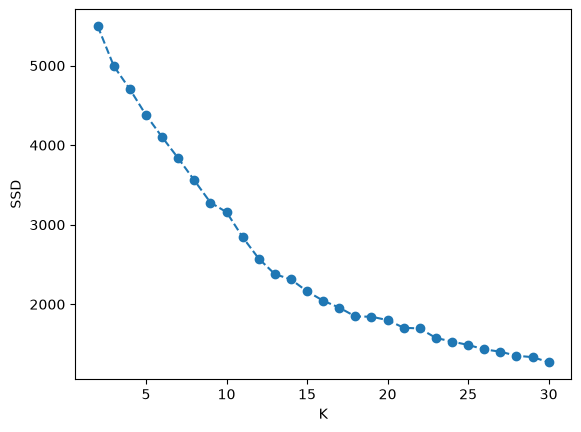

# Country Clustering with K-Means

Grouping 221 countries by demographic and economic indicators with K-Means and interpreting the clusters.

## Problem

Find groups of similar countries without any labels and explain what each group means. Since there is no ground truth, the number of clusters K has to balance clustering metrics and interpretability.

## Dataset

Country facts from the [CIA World Factbook](https://www.cia.gov/the-world-factbook/) (the compiled table is also available on Kaggle as [Countries of the World](https://www.kaggle.com/datasets/fernandol/countries-of-the-world)): 227 countries, 20 columns including population, area, GDP per capita, literacy, infant mortality, birth/death rates, phones per 1000 and economy structure. ISO-3 country codes (from the ISO 3166-1 list on Wikipedia) are used for the map.

Files: `data/CIA_Country_Facts.csv`, `data/country_iso_codes.csv`.

## Approach

- EDA: distributions, GDP by region, scatter plots, correlation heatmap and clustermap.
- Missing values: zeros for 15 tiny territories without economy data, region means for `Climate` and `Literacy`, remaining rows dropped.
- One-hot encoding of `Region`, `StandardScaler` on all features.
- K-Means for K = 2..30, comparing SSD (elbow method) and silhouette score.
- Final interpretation with K=3, plus a finer K=14 model for comparison.
- Clusters shown on a plotly choropleth map.

## Key results

The silhouette score peaks at K=17 (0.35), but 17 groups are hard to interpret. K=3 splits countries clearly by development level:

| Cluster | Countries | Typical members | GDP per capita | Literacy | Infant mortality (per 1000) |
|---|---|---|---|---|---|
| 1 - developed | 56 | Europe, North America, Japan, Australia | ~$22,700 | 96% | 6.9 |
| 0 - developing | 111 | Latin America, most of Asia, Middle East, former USSR | ~$6,700 | 85% | 25.2 |
| 2 - least developed | 54 | Mostly Sub-Saharan Africa (45 of 54) | ~$1,900 | 58% | 87.0 |





Countries whose names do not match the ISO table exactly (36, e.g. Czech Republic, Netherlands) are blank on the map.

## How to run

```bash
pip install -r ../requirements.txt
jupyter notebook country_clustering.ipynb
```

Exporting the maps to PNG uses `kaleido`, which needs Google Chrome installed (or run `plotly_get_chrome` once).

Educational project completed as part of an ML course on Stepik.
