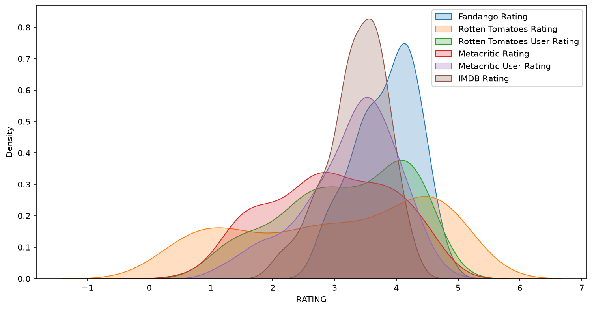
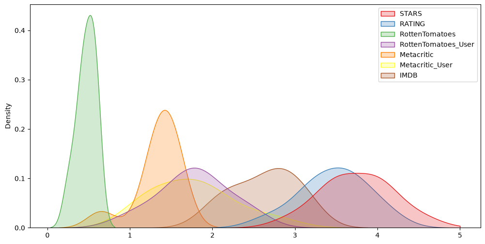

# Are Fandango Movie Ratings Inflated?

Comparing Fandango's 2015 movie ratings with Rotten Tomatoes, Metacritic and IMDb using pandas and seaborn.

## Problem

Fandango sells movie tickets and also displays movie ratings, so it has a reason to make films look better than they are. The question: are Fandango's ratings higher than its own underlying data and than the ratings on other sites?

## Dataset

Data behind the FiveThirtyEight article [Be Suspicious Of Online Movie Ratings, Especially Fandango's](https://fivethirtyeight.com/features/fandango-movies-ratings/), from the [fivethirtyeight/data repository](https://github.com/fivethirtyeight/data/tree/master/fandango):

- `data/fandango_scrape.csv`: 504 films with the stars displayed on Fandango (`STARS`), the actual average rating from the page HTML (`RATING`) and the number of votes.
- `data/all_sites_scores.csv`: 146 films with Rotten Tomatoes (critics and users), Metacritic (critics and users) and IMDb scores.

## Approach

- Extract the release year from the film title and remove films with zero votes.
- Compare displayed stars with the real rating (`STARS - RATING`).
- Explore critic vs. user scores on Rotten Tomatoes and Metacritic, and vote counts on Metacritic vs. IMDb.
- Inner merge of both tables on `FILM` (145 films) and rescale all scores to a 0-5 range.
- Compare score distributions with KDE plots, average scores per site and the 10 worst-rated films.

## Key results

Average score on a 0-5 scale for the 145 films present on all sites:

| Source | Mean score |
|---|---|
| Fandango stars (displayed) | 4.09 |
| Fandango rating (actual) | 3.84 |
| IMDb | 3.36 |
| Metacritic users | 3.25 |
| Rotten Tomatoes users | 3.18 |
| Rotten Tomatoes critics | 3.03 |
| Metacritic critics | 2.93 |

- Fandango's ratings are the highest of all sites, and the displayed stars are rounded up for 75% of films (never down), by 0.21 stars on average.
- The gap is largest for bad films: *Taken 3* shows 4.5 stars on Fandango but averages 1.88 on the other sites.





## How to run

```bash
pip install -r ../requirements.txt
jupyter notebook fandango_analysis.ipynb
```

Educational project completed as part of an ML course on Stepik.
