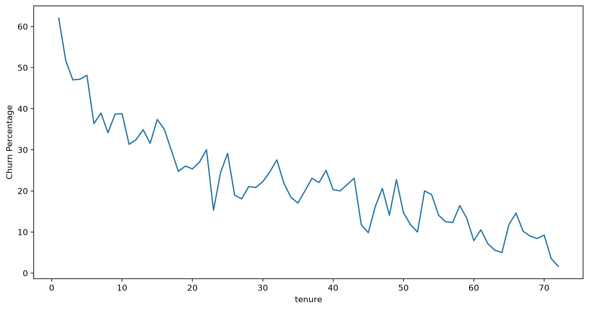
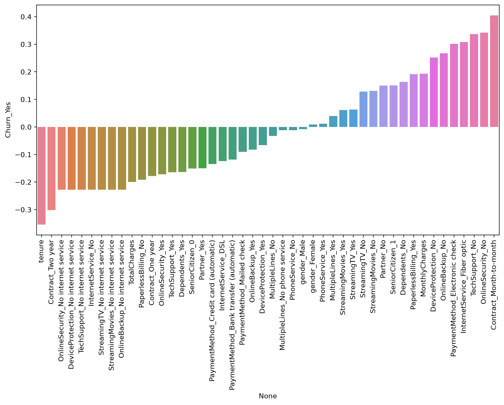

# Telco Customer Churn Prediction

Predicting which telecom customers will leave the company, comparing four tree-based classifiers.

## Problem

Identify customers who are likely to churn so the company can contact them with a retention offer. Missing a real churner is more costly than a false alarm, so the main metric is recall on the churn class.

## Dataset

[Telco Customer Churn](https://www.kaggle.com/datasets/blastchar/telco-customer-churn) (IBM sample data, Kaggle). The version used here has 7,032 customers (rows with empty `TotalCharges` removed) and 19 features: demographics, phone and internet services, contract type, payment method and charges. Target: `Churn` (Yes/No), about 27% positive.

File: `data/Telco-Customer-Churn.csv`.

## Approach

- EDA: class balance, charges by contract type, correlation of one-hot encoded features with churn, churn rate by tenure and tenure cohorts.
- Preprocessing: drop `customerID`, one-hot encode categorical features, 90/10 train/test split.
- Models: Decision Tree, Random Forest, AdaBoost, Gradient Boosting, each tuned with 5-fold `GridSearchCV` (scoring = F1).
- Evaluation: classification report and confusion matrix on the test set, feature importances of the tree.

## Key results

Churn class (1) on the test set (704 customers, 147 churners):

| Model | Precision | Recall | F1 |
|---|---|---|---|
| Decision Tree | 0.42 | **0.78** | 0.54 |
| Random Forest | 0.44 | 0.72 | 0.54 |
| AdaBoost | **0.62** | 0.50 | **0.55** |
| Gradient Boosting | 0.57 | 0.49 | 0.53 |

F1 is almost the same for all models. I would pick the Decision Tree: it catches 115 of 147 churners (AdaBoost catches 74), and the extra false alarms only cost a retention offer. Its most important features are contract type, fiber optic internet and tenure.





## How to run

```bash
pip install -r ../requirements.txt
jupyter notebook churn_analysis.ipynb
```

The grid searches take a few minutes on a laptop.

Educational project completed as part of an ML course on Stepik.
