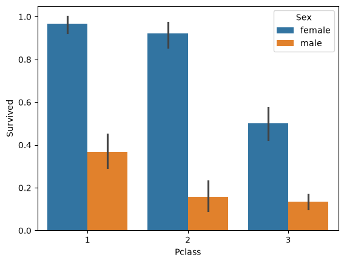
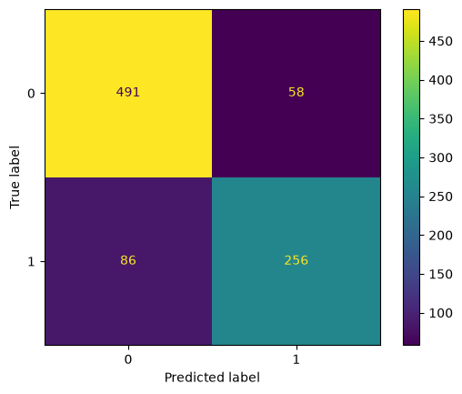

# Titanic: Survival Prediction (Kaggle)

My first Kaggle competition: predicting Titanic passenger survival with engineered features, sklearn pipelines and an analysis of the model's errors.

## Problem

Predict whether a passenger survived from their ticket class, sex, age, family and ticket data. The competition metric is accuracy on a hidden test set.

## Dataset

[Titanic - Machine Learning from Disaster](https://www.kaggle.com/competitions/titanic) on Kaggle: 891 labeled passengers in `train.csv` and 418 unlabeled passengers in `test.csv`.

The data is not included in this repository (Kaggle competition rules). Download it into `data/`:

```bash
kaggle competitions download -c titanic -p data
unzip data/titanic.zip -d data
```

## Approach

- EDA focused on survival rates, including a check whether the port of embarkation is just a proxy for class (it isn't: the difference remains inside 3rd class).
- Feature engineering: `AgeGroup` from the title in the name (splitting "Miss" into child/adult by `Parch`), `FamilySize`, `Is_alone`, `HasCabin`, `Ticket_count`.
- Missing `Age` filled with the median of the passenger's `AgeGroup`, using statistics from train only.
- Baseline: manual preprocessing + Logistic Regression.
- Then the same preprocessing as a `Pipeline` with `ColumnTransformer`, comparing Logistic Regression, KNN, SVM and Decision Tree with 5-fold CV and `GridSearchCV`.
- Error analysis of out-of-fold SVM predictions by passenger group.

## Key results

| Model | CV accuracy (tuned) | Kaggle score |
|---|---|---|
| Baseline: all women survive | - | 0.76555 |
| Logistic Regression (manual preprocessing) | 0.829 | 0.77272 |
| KNN | 0.824 | - |
| Decision Tree | 0.827 | - |
| **SVM (rbf, C=2, gamma=0.1)** | **0.838** | **0.77751** |

- The title-based `AgeGroup` and `Sex` are the strongest features.
- The model is weakest on 3rd-class women: among women from Southampton with a small family it predicts survival for 50 of 54, while only 25 survived.





## How to run

```bash
pip install -r ../requirements.txt
# download the data into data/ (see above)
jupyter notebook titanic_survival.ipynb
```

The notebook writes `baseline.csv` and `solution.csv` in Kaggle submission format.

Personal project: my first Kaggle competition, done while learning ML.
